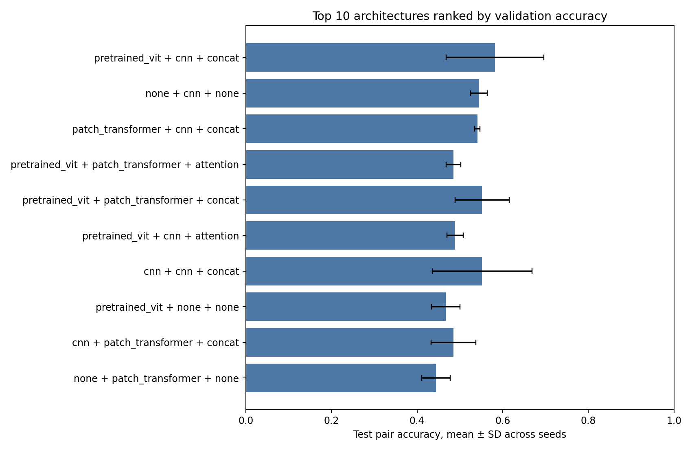
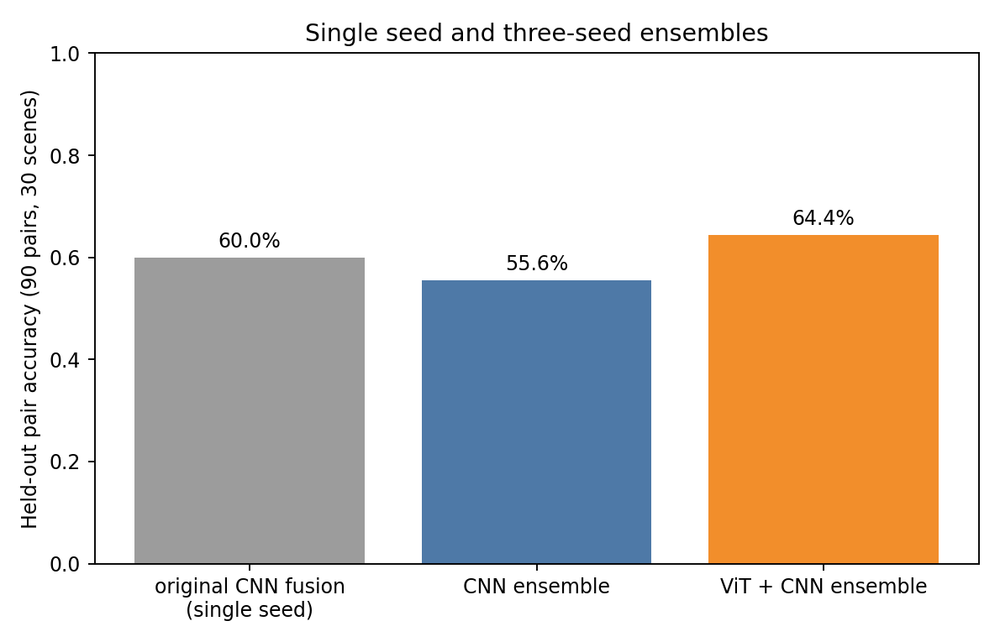

# GPU 模型对照结果

## 实验设置

- 数据：150 个合成场景，每类 50 个；训练 90、验证 30、测试 30 个场景。每个场景有 3 个接触点，测试集共 90 对视触样本。
- 设备：NVIDIA GeForce RTX 5070 Ti Laptop GPU，PyTorch 2.11.0+cu128。所有新架构的可训练参数都在 GPU 上训练；预训练 ViT 的特征提取也在 GPU 上完成，ViT 主干冻结。
- 比较 17 种架构：视觉编码器为 CNN、从零训练的小型 patch Transformer、冻结的预训练 ViT；触觉编码器为 CNN 或 patch Transformer；融合为特征拼接或 3-token 注意力 Transformer。另有各编码器的单模态对照。
- 每种架构使用种子 42、43、44，最多训练 45 轮，验证集 10 轮无改进则早停。以**三个种子的平均验证准确率**选架构；测试集不参与选择。
- 指标是单次接触的分类准确率。测试集三个触点并非相互独立；不应把 90 对样本当作 90 个独立物体。

完整逐架构结果见 `architecture_comparison.csv`。下表为验证集排名前六的架构：

| 视觉 | 触觉 | 融合 | 验证准确率均值 | 测试准确率均值 ± 标准差 |
|---|---|---|---:|---:|
| 预训练 ViT | CNN | 拼接 | 59.3% | 58.1% ± 11.4% |
| 无 | CNN | 无 | 57.4% | 54.4% ± 1.9% |
| Patch Transformer | CNN | 拼接 | 57.0% | 55.2% ± 2.3% |
| 预训练 ViT | CNN | 注意力 | 53.7% | 50.7% ± 2.3% |
| 预训练 ViT | Patch Transformer | 拼接 | 53.7% | 55.6% ± 6.9% |
| CNN | CNN | 拼接 | 53.0% | 55.2% ± 11.7% |



## 三种子集成复核

对验证集选出的预训练 ViT＋触觉 CNN＋拼接方案，将三个随机种子的预测概率取平均，并与同样方式集成的 CNN＋CNN＋拼接方案比较：

| 模型 | 测试准确率 |
|---|---:|
| 原始 CNN 融合基线，GPU 重训，单种子 | 60.0% |
| 新架构 CNN＋CNN＋拼接，三种子集成 | 55.6% |
| 预训练 ViT＋触觉 CNN＋拼接，三种子集成 | **64.4%** |

两种三种子集成的差值为 **8.9 个百分点**。按 30 个测试场景成组重采样的配对 bootstrap 95% 区间为 **−4.4 至 21.1 个百分点**，跨过 0。因此这组数据不能证明 ViT 一定优于 CNN；它只说明该配置在此次测试中取得较高分数。预训练 ViT 使用外部数据预训练，和从零训练的 CNN 也不是同等训练信息量。



原始主动探索流程仍使用视觉 CNN 与触觉 CNN 的概率更新。GPU 重训后，主动选点在 30 个测试场景中为 30/30，随机选点为 25/30；这部分**没有使用新的 ViT 融合模型**。

## 解释与限制

触觉信息被设计在不同接触点：有些点对类别没有区分力。因此单次接触分类的准确率有限，而主动选择接触点、最多触碰两次会显著提高结果。当前“表面”由程序化深度场生成，再交给 TACTO 渲染；没有 PyBullet 中真实传感器碰撞、力学变形或真实材料数据。30 个独立测试场景很少，所有结论限于这个合成任务。

复现命令：

```bash
./setup.sh
./run.sh all 50 35
./run.sh compare
```
